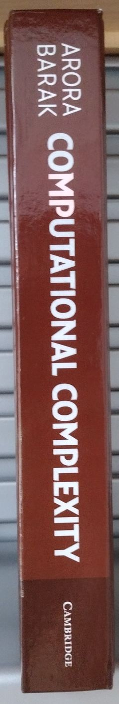

About Arora and Barak's Book
======================

Errata
---------

So, I wrote some below.
I checked the [authors' website](https://theory.cs.princeton.edu/complexity/) and the [publisher's website](https://www.cambridge.org/core/books/computational-complexity/3453CAFDEB0B4820B186FE69A64E1086?utm_campaign=shareaholic&utm_medium=copy_link&utm_source=bookmark) but did not find errata.

- P. 72, 2nd bullet, "Thus for large enough formulae $$\psi$$ ... string of the type $$\psi 01^{H(\card{\psi})}$$ ...." It should be $$\psi 01^{n^{H(\card{\psi})}}$$.

- P. 75, 1st paragraphy, "... ensuring $$1^n \in B_u$$." It should be $$U_B$$.

- P. 114, last (line) equation in the Meyer's Theorem, "$$T(x, C(i), ...)$$," I suppose that $$T$$ should also take $$i$$ as input, where $$i$$ is polynomial in the input size $$n$$ as the computation time is exponential in $$n$$.

- P. 131, Definition 7.6, $$x\notin L$$ should imply that $$\Pr[M(x)=0] = 1$$.

- P. 158, Section 8.3.1, $$x_i \vee \bar{x_j} \vee \bar{x_k}$$ should map to $$1 - (1-X_i)(X_j)(1-X_k)$$. That is, logical (a OR b) is mapped to NOT((NOT a) AND (NOT b)).

- P. 159, Eq (8.8), should be $$g(b_1, \dots, b_n)$$.

Book Spine
---------

It was interesting to see book spines on shelves when books were printed.
Now they are digital, and spines disappear.
Here is an image of the spine.

{: style="display: block; margin: 0 auto; max-height: 30em;"}

