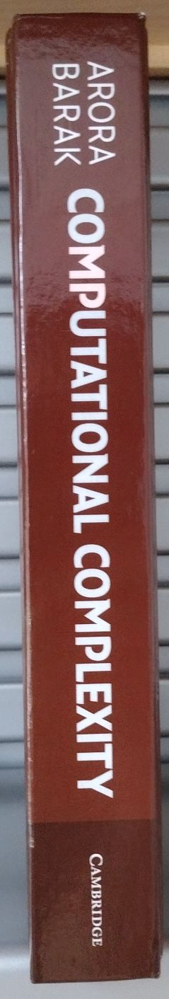

About Arora and Barak's Book
======================

Errata
---------

So, I wrote some below.
I checked the [authors' website](https://theory.cs.princeton.edu/complexity/) and the [publisher's website](https://www.cambridge.org/core/books/computational-complexity/3453CAFDEB0B4820B186FE69A64E1086?utm_campaign=shareaholic&utm_medium=copy_link&utm_source=bookmark) but did not find errata.

- P. 72, 2nd bullet, "Thus for large enough formulae $$\psi$$ ... string of the type $$\psi 01^{H(\card{\psi})}$$ ...." It should be $$\psi 01^{n^{H(\card{\psi})}}$$.

- P. 75, 1st paragraphy, "... ensuring $$1^n \in B_u$$." It should be $$U_B$$.

- P. 114, last (line) equation in the Meyer's Theorem, "$$T(x, C(i), ...)$$," I suppose that $$T$$ should also take $$i$$ as input, where $$i$$ is polynomial in the input size $$n$$ as the computation time is exponential in $$n$$.

- P. 131, Definition 7.6, $$x\notin L$$ should imply that $$\Pr[M(x)=0] = 1$$.

- P. 158, Section 8.3.1, $$x_i \vee \bar{x_j} \vee \bar{x_k}$$ should map to $$1 - (1-X_i)(X_j)(1-X_k)$$. That is, logical (a OR b) is mapped to NOT((NOT a) AND (NOT b)).

- P. 159, Eq (8.8), should be $$g(b_1, \dots, b_n)$$.

- P. 248, Proof (Of Theorem 11.15).
  It proves that if for some constant $$\rho < 1$$, the $$\rho$$-approximation of INDSET is NP-hard, then for all constant $$\rho' < 1$$, the $$\rho$$-approximation is also NP-hard.
  The proof is rough in grammar, but more importantly, we shall construct the graph $$G^k$$ by setting *two subsets $$S_1,S_2$$ are adjacent if $$S_1 \cup S_2$$ is **NOT** an independent set in $$GG$$* (the typo missed the "not").
  That way, later in the proof, $$U$$ is an indpendent set of $$G$$ iff all $$k$$-subsets of $$U$$ is an independent set of $$G^k$$.

- P. 290, Proof of the Switching Lemma. 
  The proof needs polish with a few typos, e.g., "sero" should be zero.
  I clarify below on the injection from a bad $$t$$-restriction $$\rho$$ to $$(\rho\sigma, c)$$ for a disjoint $$s$$-restriction $$\sigma$$ and a string $$c$$ of $$O(s \log k)$$ bits.
  The high-level idea is to map from non-$$s$$-CNF $$f_\rho$$ to a nonzero $$f_{\rho\sigma}$$ and $$c$$ while ensuring we can recover $$\rho$$ (to get injectivity for the counting).
  Notice that in this context, nonzero, the term or restriction cannot be 1, otherwise it gives a trivial CNF.
  Here, by $$f_\rho$$, I mean restricting some variables of $$f$$ by the partial assignment $$\rho$$.

  We are given a k-DNF $$f$$ as a big OR of many terms, each term is AND over $$k$$ literals.
  Because $$f_\rho$$ is not s-CNF, there exists $$\pi$$ such that makes $$f_{\rho\pi} = 0$$ and $$\pi$$ assigns more than $$s$$ variables.
  Notice that $$\pi$$ zeros all DNF-terms of $$f_{\rho\pi}$$.
  Each variable of $$\sigma$$ is in $$\pi$$, but they are assigned differently as follows.
  1. Let $$i = 0$$. 
  2. Find the first nonzero term $$t_i$$ in $$f_{\rho\sigma_1 \cdots \sigma_{i-1}}$$.
     Find the variables of $$t_i$$ that intersects with $$\pi \setminus \sigma_1 \cdots \sigma_{i-1}$$.
     Assign the intersection so that $$t_i$$ remains nonzero; let the assignment be $$\sigma_i$$.
     The term $$t_i$$, the intersection, and the assignment are nonempty by $$\pi$$.
  3. Increment $$i$$ and repeat the previous step until the length of $$\sigma_1 \cdots \sigma_{i}$$ is exactly $$s$$.
  4. For each $$i$$, write in $$c$$ the indices of $$\sigma_i$$ variables in the term $$t_i$$.
  
  The invariant is that for all $$i < j$$, $$t_i$$ is never assigned by $$\sigma_{j}$$.
  Therefore, in $$f_{\rho\sigma}$$, the first nonzero term is $$t_1$$, the second is $$t_2$$, and so on, and then we we can recover $$\rho$$ from $$(\rho\sigma, c)$$.

Book Spine
---------

It was interesting to see book spines on shelves when books were printed.
Now they are digital, and spines disappear.
Here is an image of the spine.

{: style="display: block; margin: 0 auto; max-height: 30em;"}

